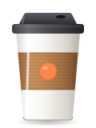

# MadeWith

The credit line every site we build carries in its footer: "Făcut cu [paper coffee cup] de Echipa de Tocilari", with the team name as an orange link to echipadetocilari.ro. Decided on 16.11.2026: no avatar, orange link, realistic cup.

Markup:

```html
<p class="ect-madewith">Făcut cu  de <a href="https://echipadetocilari.ro/" rel="noopener">Echipa de Tocilari</a></p>
```

- `coffee-cup.svg`: white takeaway cup with a dark lid, kraft sleeve and an orange (`#fd8649`) dot on the sleeve, shaded with gradients. Copy it into the client site's assets; `alt="cafea"` so the sentence reads correctly to screen readers.
- The cup is `2.6em` wide, so it scales with the line's font size. The text is `ink-muted` on light footers and `#c9c9ce` on dark ones.
- The link is `orange`, 600, underlined 3px below, with a 44px hit area and a visible focus outline. On white or light grey the orange is about 2.4:1, below WCAG AA; on dark footers it passes. On a light footer, use `#c45f2a` for the link if the client site must meet AA.
- Place it in the bottom row of the footer, centred on phones. It doesn't replace the client's own copyright line.

Preview: `preview.html` (light and dark footer), screenshot in `preview.png`.
